# 🎬 Awesome Video Editing & Media Transcoding GUI

  <strong>A curated list of battle-tested FFmpeg visual frontends, batch media transcoders, lossless video cutters, desktop & browser NLEs, and hardware-accelerated video conversion pipelines.</strong>

  <a href="#-sector-overview--market-dynamics">Sector Overview</a> •
  <a href="#-saas--cloud-hosted-platforms">SaaS Platforms</a> •
  <a href="#-open-source-github-projects">Open-Source Projects</a> •
  <a href="#-how-to-contribute">How to Contribute</a> •
  <a href="#-support--community">Support</a> •
  <a href="#-star-history">Star History</a>

---

## 📌 Introduction & Scope

Welcome to the definitive catalog of **Video Editing & Media Transcoding Graphical Interfaces (GUIs)**. This repository tracks both elite **SaaS/hosted platforms** and powerhouse **open-source desktop & web projects** engineered for:

- **Graphical FFmpeg Frontends**: Visual wrappers that turn complex command-line arguments into simple, reproducible workflows.
- **Hardware-Accelerated Transcoders**: Batch converters supporting AV1, HEVC (H.265), AVC (H.264), VP9, and ProRes via NVENC, Intel QSV, AMD AMF, Apple VideoToolbox, and VAAPI.
- **Lossless Cutters & Remuxers**: Frame-accurate cutting, trimming, audio-track extraction, and stream multiplexing without CPU-intensive re-encoding.
- **Desktop & Web NLEs**: Non-linear editors ranging from browser-based WebAssembly editors to multi-track professional desktop studios.
- **Automated Media Processing**: Self-hosted home-lab library optimizers, folder watchers, and visual node-based media workflows.

---

## 🌐 Sector Overview & Market Dynamics

The global video editing software and media transcoding market was valued at **$3.4 Billion in 2024** and is projected to expand to **$6.2 Billion by 2032**, demonstrating a compound annual growth rate (CAGR) of **~7.8%**.

The market exhibits **moderate fragmentation with polarized concentration**: enterprise-grade film and broadcast post-production remains heavily concentrated under established legacy software (Adobe Premiere Pro, Apple Final Cut Pro, Blackmagic DaVinci Resolve), while cloud-first creator workflows, automated AI clipping, text-based NLEs, and browser media transcoding have fragmented dramatically across fast-growing venture-backed startups and open-source web ecosystems.

---

## 💼 SaaS & Cloud-Hosted Platforms

*Ranked in descending order by company scale (market capitalization, valuation, or estimated annual recurring revenue).*

| 🚀 Platform / Company | 🏢 Company Size (Valuation / Revenue) | 💳 Starting Pricing | 🎁 Free Tier / Trial Limits | 🛠️ Core Focus & Capabilities |
| :--- | :--- | :--- | :--- | :--- |
| **[Microsoft Clipchamp](https://clipchamp.com)** | ~$3.1T Market Cap (Microsoft) | $11.99/month ($119.99/year) for Clipchamp Premium | **Free forever plan**: Unlimited watermark-free 1080p exports, standard filters & basic stock library | Web & Windows 11 native video editor featuring multi-track timelines, auto-captions, screen/cam recording, and cloud presets. |
| **[Adobe Premiere Pro & Media Encoder](https://adobe.com)** | ~$210B Market Cap / $21.4B ARR | $22.99/month (annual subscription billed monthly) | **7-day free trial**: Complete access to all Premiere Pro & Media Encoder features, GPU hardware acceleration & cloud tools | Industry-standard professional non-linear video editing suite with Frame.io cloud review integration and batch media encoding. |
| **[Runway Video Editor](https://runwayml.com)** | $1.5B Valuation (Series C) | $12/user/month (billed annually, $144/year) | **Free forever plan**: 125 one-time generation credits, 3 video projects, 720p export resolution & 5GB cloud storage | Browser-based generative AI creative studio combining multi-track editing with AI inpainting, slow-motion, and motion brush. |
| **[Descript](https://descript.com)** | ~$550M Valuation (Series C) | $12/user/month (billed annually) for Hobbyist | **Free forever plan**: 1 transcription hour/month, 1 watermark-free 720p export/month, 1 AI voiceover clone (1,000 words) | Text/transcript-based video & podcast editor featuring Underlord AI, automatic filler-word removal, and Studio Sound enhancement. |
| **[Riverside.fm](https://riverside.fm)** | ~$250M Valuation (Series B) | $15/month (billed annually) for Standard tier | **Free forever plan**: 2 hours of separate local 4K video/audio recording, 720p watermarked exports & unlimited text-based cuts | Cloud recording studio capturing uncompressed local multi-track audio/video with automated AI social clip generation. |
| **[InVideo AI](https://invideo.io)** | ~$120M Valuation (Series A) | $20/month (billed annually) for Plus plan | **Free forever plan**: 10 mins/week AI video generation, 4 exports/week with InVideo watermark & 10GB cloud storage | Prompt-to-video AI platform generating complete scripted videos with stock media, automated voiceovers, and canvas timeline editing. |
| **[Kapwing](https://kapwing.com)** | ~$100M Valuation (Series A) | $16/user/month (billed annually) for Pro tier | **Free forever plan**: Videos up to 7 minutes long, 720p export with watermark, and 10 mins/month of auto-subtitles | Collaborative cloud video editing workspace offering Smart Cut silence removal, meme templates, aspect-ratio resizing & cloud rendering. |
| **[WeVideo](https://wevideo.com)** | ~$80M Valuation | $4.99/month (billed annually) for Power plan | **Free forever plan**: 5 minutes/month published video time, 480p resolution, and 1GB storage with WeVideo watermark | Cloud-based collaborative timeline editor built for education, classroom storytelling, chromakey green screen & screen capture. |
| **[VEED.IO](https://veed.io)** | ~$30M+ ARR (Bootstrapped/Funded) | $12/user/month (billed annually) for Basic | **Free forever plan**: 10-minute video export limit, 720p resolution with watermark, and 30 mins/month of auto-generated subtitles | Browser-based AI video studio featuring dynamic animated subtitles, background noise removal, video compression & aspect-ratio conversion. |
| **[CloudConvert](https://cloudconvert.com)** | ~$10M+ ARR (Independent SaaS) | $9.00 one-off package (500 credits) or $9.00/month (1,000 credits) | **Free forever plan**: 25 conversion credits per day with up to 1GB file size limit and full access to video/audio codec options | High-volume cloud file and media converter GUI supporting 200+ formats, batch jobs, trim ranges, resolution scaling & video codecs. |
| **[FlexClip](https://flexclip.com)** | ~$5M-$10M Annual Revenue | $9.99/month (billed annually) for Plus plan | **Free forever plan**: 12 video projects, 720p SD downloads, 1 stock video/audio per project & up to 1-minute video length | Drag-and-drop online video maker and compressor equipped with designer templates, auto-subtitling, and fast social media exports. |

---

## ⚡ Open-Source GitHub Projects

*Ranked in descending order by GitHub stargazers count. Each star badge links directly to the project's stargazers community.*

- **[OpenCut (OpenCut-app/OpenCut)](https://github.com/OpenCut-app/OpenCut)**   
  Free, open-source web and desktop video editor engineered as a privacy-focused alternative to CapCut with multi-track timelines and local rendering.

- **[OBS Studio (obsproject/obs-studio)](https://github.com/obsproject/obs-studio)**   
  Industry-standard open-source suite for live video compositing, screen recording, multi-track audio capture, and real-time hardware encoding.

- **[Remotion (remotion-dev/remotion)](https://github.com/remotion-dev/remotion)**   
  Premier open-source framework and player GUI for building programmatic videos, dynamic subtitles, data animations, and automated rendering with React.

- **[FFmpeg (FFmpeg/FFmpeg)](https://github.com/FFmpeg/FFmpeg)**   
  The universal, foundational open-source multimedia engine, `libavcodec`, and CLI utility powering virtually all modern video converters, transcoders, and NLEs.

- **[LosslessCut (mifi/lossless-cut)](https://github.com/mifi/lossless-cut)**   
  The Swiss Army knife of lossless video/audio cutting—ultra-fast Electron GUI for trimming, cutting, merging, and remuxing media streams via FFmpeg without re-encoding.

- **[HandBrake (HandBrake/HandBrake)](https://github.com/HandBrake/HandBrake)**   
  The definitive open-source multithreaded video transcoder GUI for converting DVD/Blu-ray and video files into optimized AV1, HEVC, and H.264 formats with hardware acceleration.

- **[Video2X (k4yt3x/video2x)](https://github.com/k4yt3x/video2x)**   
  Open-source GUI and CLI video upscaling and frame interpolation framework integrating Real-ESRGAN, Real-CUGAN, Anime4K, and RIFE with FFmpeg encoding.

- **[FFmpeg.wasm (ffmpegwasm/ffmpeg.wasm)](https://github.com/ffmpegwasm/ffmpeg.wasm)**   
  Pure WebAssembly port of FFmpeg enabling client-side video transcoding, audio extraction, and trimming directly in the web browser without server infrastructure.

- **[Shotcut (mltframework/shotcut)](https://github.com/mltframework/shotcut)**   
  Cross-platform open-source non-linear video editor powered by MLT and FFmpeg featuring native multi-format timelines, 4K/HDR support, and hardware-accelerated exports.

- **[MoviePy (Zulko/moviepy)](https://github.com/Zulko/moviepy)**   
  Versatile open-source Python library for programmatic video editing, non-linear compositing, animated GIF generation, and batch post-production scripts.

- **[Subtitle Edit (SubtitleEdit/subtitleedit)](https://github.com/SubtitleEdit/subtitleedit)**   
  Comprehensive open-source subtitle editor with visual audio waveform syncing, Whisper speech-to-text transcription, translation, and support for 300+ caption formats.

- **[FFmpeg-Builds (FFmpeg-Builds/FFmpeg-Builds)](https://github.com/FFmpeg-Builds/FFmpeg-Builds)**   
  Automated CI builds of FFmpeg master and release branches with full GPU hardware acceleration libraries (NVENC, QSV, AMF, VULKAN, libvmaf, libsvtav1).

- **[LAV Filters (Nevcairiel/LAVFilters)](https://github.com/Nevcairiel/LAVFilters)**   
  Open-source DirectShow media splitter and audio/video decoders based on FFmpeg libraries, providing hardware-accelerated decoding across media playback GUIs.

- **[Olive Video Editor (olive-editor/olive)](https://github.com/olive-editor/olive)**   
  Modern open-source professional non-linear video editor featuring a node-based compositing pipeline, OpenColorIO color management, and high-performance playback.

- **[OpenShot (OpenShot/openshot-qt)](https://github.com/OpenShot/openshot-qt)**   
  Easy-to-use open-source video editor built with Python, Qt, and `libopenshot` offering multi-layer timeline tracks, keyframe animations, and 3D titles.

- **[Kdenlive (KDE/kdenlive)](https://github.com/KDE/kdenlive)**   
  Flagship KDE open-source non-linear video editor with proxy editing, color scopes, audio mixers, keyframe curves, and integrated Whisper speech-to-text subtitling.

- **[Auto-Editor (WyattBlue/auto-editor)](https://github.com/WyattBlue/auto-editor)**   
  High-speed command-line and automation tool that analyzes audio/video to cut dead air and silence, exporting directly to Premiere Pro, DaVinci Resolve, Final Cut, and Shotcut.

- **[Editly (mifi/editly)](https://github.com/mifi/editly)**   
  Slick, declarative Node.js framework and CLI for programmatic video editing, combining clips, dynamic titles, Ken Burns transitions, and music tracks into polished videos.

- **[Tdarr (HaveAGitGat/Tdarr)](https://github.com/HaveAGitGat/Tdarr)**   
  Distributed conditional media library transcoding system with an interactive web GUI that automatically transcodes video/audio collections into AV1 or HEVC.

- **[Aegisub (Aegisub/Aegisub)](https://github.com/Aegisub/Aegisub)**   
  Renowned open-source cross-platform subtitle editor tailored for typesetting Advanced SubStation Alpha (`.ass`) captions with audio waveform visualization.

- **[StaxRip (staxrip/staxrip)](https://github.com/staxrip/staxrip)**   
  Powerful open-source Windows video encoding GUI supporting AviSynth+, VapourSynth, FFmpeg, NVENC, QSV, and rav1e for batch AV1, x265, and x264 pipelines.

- **[Shutter Encoder (paulpacifico/shutter-encoder)](https://github.com/paulpacifico/shutter-encoder)**   
  Swiss-army media converter and post-production GUI built on FFmpeg for broadcast codecs (ProRes, DNxHD, XDCAM), lossless trimming, color calibration, and audio normalisation.

- **[Gyan FFmpeg Builds (GyanD/codexffmpeg)](https://github.com/GyanD/codexffmpeg)**   
  Well-maintained, official Windows builds of FFmpeg and codec libraries including full HarfBuzz, FreeType, OpenCL, and Vulkan hardware encoding support.

- **[Unmanic (Unmanic/unmanic)](https://github.com/Unmanic/unmanic)**   
  Self-hosted automated media library transcoding manager with an intuitive web dashboard, worker concurrency control, and customizable FFmpeg/VAAPI task plugins.

- **[MediaInfo (MediaArea/MediaInfo)](https://github.com/MediaArea/MediaInfo)**   
  Indispensable open-source GUI and CLI utility providing comprehensive technical metadata and stream information for all video, audio, and container formats.

- **[Av1an (rust-av/Av1an)](https://github.com/rust-av/Av1an)**   
  High-efficiency Rust-powered parallel chunked video encoding framework featuring VMAF-targeted quality probes and support for SVT-AV1, rav1e, aomenc, and x265.

- **[FastFlix (cdgriffith/FastFlix)](https://github.com/cdgriffith/FastFlix)**   
  User-friendly open-source multi-platform GUI for FFmpeg encoding with presets for AV1, HEVC, VP9, HDR10 tone mapping, crop preview, and audio extraction.

- **[FFmpeg Batch AV Converter (eibols/ffmpeg_batch)](https://github.com/eibols/ffmpeg_batch)**   
  Comprehensive Windows GUI front-end for FFmpeg delivering multi-file parallel batch processing, queue management, live preview, and automated stream concatenation.

- **[OmniClip (omni-media/omniclip)](https://github.com/omni-media/omniclip)**   
  Browser-native client-side video editor operating 100% locally with WebCodecs, WebGL, and WebAssembly with zero file uploads or cloud storage latency.

- **[FFmpeg Commander (alfg/ffmpeg-commander)](https://github.com/alfg/ffmpeg-commander)**   
  Visual web-based FFmpeg command generator and GUI helping developers and video editors configure video codecs, filters, audio bitrates, and containers visually.

- **[AviDemux (mean00/avidemux2)](https://github.com/mean00/avidemux2)**   
  Fast, lightweight open-source video editor and converter designed for straightforward cutting, filtering, and encoding tasks without project overhead.

- **[MystiQ (swl-x/MystiQ)](https://github.com/swl-x/MystiQ)**   
  Clean and elegant Qt5 C++ GUI frontend for FFmpeg, offering presets for dozens of devices and multimedia formats with a clean beginner-friendly UI.

- **[VirtualDub2 (shekh/VirtualDub2)](https://github.com/shekh/VirtualDub2)**   
  Streamlined open-source video processing and transcoding utility with built-in FFmpeg input/output plugins, deep color support, and AviSynth frame serving.

---

## 🤝 How to Contribute

Contributions are warmly welcomed! To suggest a new tool, update pricing, or enhance descriptions:

1. **Fork** this repository.
2. **Create a branch** for your update: `git checkout -b feature/new-video-gui`.
3. **Ensure strict criteria**:
   - Provide direct links to official websites or GitHub repositories.
   - For SaaS products, include exact starting pricing and exact free tier/trial limits.
   - For open-source tools, include the standard shields.io social star badge linking to `/stargazers`.
4. **Commit your changes**: `git commit -m "Add <Tool Name> to video editing list"`.
5. **Open a Pull Request** with a concise summary of the addition.

---

## 💖 Support & Community

If this curated ecosystem helps your production workflow, media encoding pipelines, or creator tech stack:

- ⭐ **Star this repository** to show your appreciation and bookmark it for updates!
- 🍴 **Fork the project** to maintain your personal reference or share improvements.
- 📢 **Share with fellow editors, creators, and media engineers**.
- ☕ **Support development & maintenance**: Consider buying a coffee or becoming a sponsor via the [GitHub Sponsors Dashboard](https://github.com/sponsors/ishandutta2007).

---

## 📈 Star History

#`
`

---

## ⚖️ Disclaimer

*All trademarks, logos, and brand names are the property of their respective owners. Company names, product names, and service names used in this document are for identification purposes only. Pricing, feature sets, and repository statistics are subject to change over time.*
